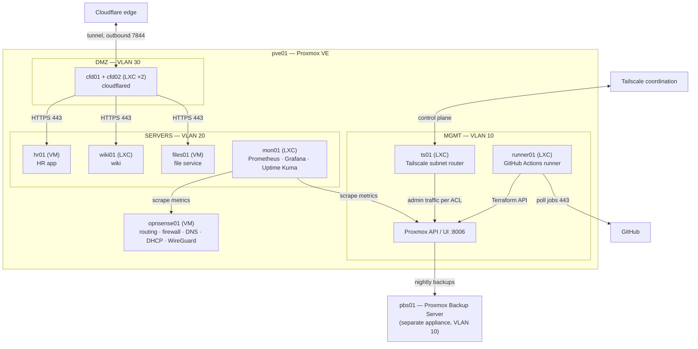

# C4 Level 2 — Containers

**Question answered:** *Which runnable parts make up the platform, where do they run, and how
do they talk to each other?* (In C4, a "container" is any separately running unit — a VM,
an LXC, a service — not only Docker containers.)
**Audience:** architects, engineers, operations.

| Container | Technology | Responsibility | Data | Rebuild strategy |
|-----------|------------|----------------|------|------------------|
| `opnsense01` | OPNsense VM | Inter-zone routing and filtering, NAT, DNS, DHCP, NTP, WireGuard | Config (`config.xml`) | Restore VM or reinstall + import config |
| `cfd01/02` | cloudflared on Debian LXC (2 replicas) | Outbound tunnel to Cloudflare | None (token) | Terraform + Ansible |
| `files01` | File service on Debian VM | Files and sharing | **2 TB+ user files** | Restore from PBS |
| `wiki01` | Wiki on Debian LXC | Documentation | Pages, DB | Restore from PBS |
| `hr01` | HR web app on Debian VM | HR processes | **Personal data** | Restore from PBS |
| `mon01` | Prometheus, Grafana, Uptime Kuma | Metrics, dashboards, alerts | Metrics (30 days) | Restore or rebuild (history optional) |
| `ts01` | Tailscale on Debian LXC | Subnet router for admins | None (auth key) | Terraform + Ansible |
| `runner01` | GitHub Actions runner | Executes IaC pipelines in the lab | None | Terraform + Ansible |
| Proxmox API/UI | Proxmox VE | Guest lifecycle | Host config | Reinstall from docs + IaC |
| `pbs01` | Proxmox Backup Server | Backup storage | **Backups** | Reinstall; data via off-site copy |

Simplified for readability: Tailscale admins also reach SERVERS, the runner also uses SSH (Ansible) to SERVERS, and monitoring also scrapes the apps — see [traffic flows](traffic-flows.md) and the [firewall rule matrix](../lld-network.md#5-firewall-rule-matrix).

Previous level: [C4 context](c4-context.md). Network view: [network topology](network-topology.md).
