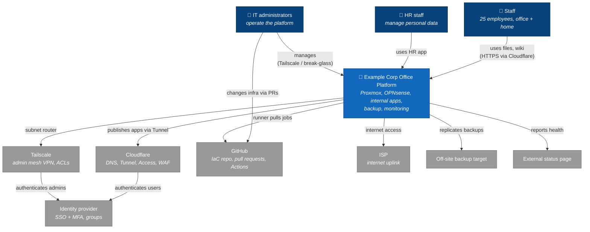

# C4 Level 1 — System Context

**Question answered:** *Who uses the platform, and which external systems does it depend on?*
**Audience:** everyone, including management.

| Element | Type | Description |
|---------|------|-------------|
| Staff, HR staff, IT administrators | People | See [requirements §3](../../01-requirements/requirements.md#3-stakeholders-and-raci) |
| Example Corp Office Platform | **The system in scope** | Everything on `pve01` and `pbs01` |
| Identity provider | External SaaS | Source of truth for users, groups and MFA |
| Cloudflare | External SaaS | Public DNS, Tunnel, Access, WAF |
| Tailscale | External SaaS | Coordination server for the admin mesh VPN |
| GitHub | External SaaS | Source of truth for infrastructure code |
| ISP | External | Single internet uplink (HLD risk R-3) |
| Off-site backup target | External | Third backup copy |
| External status page | External SaaS | Outage communication independent of the office |

Next zoom level: [C4 container](c4-container.md).
