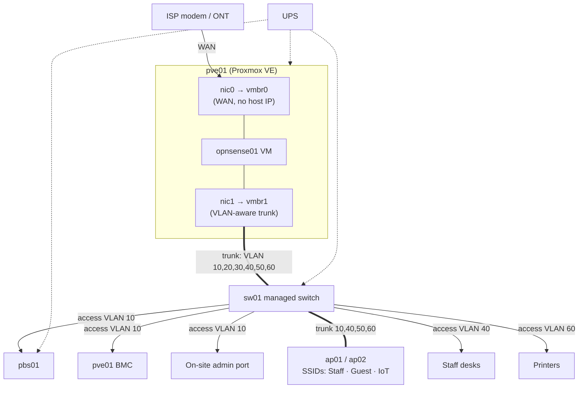
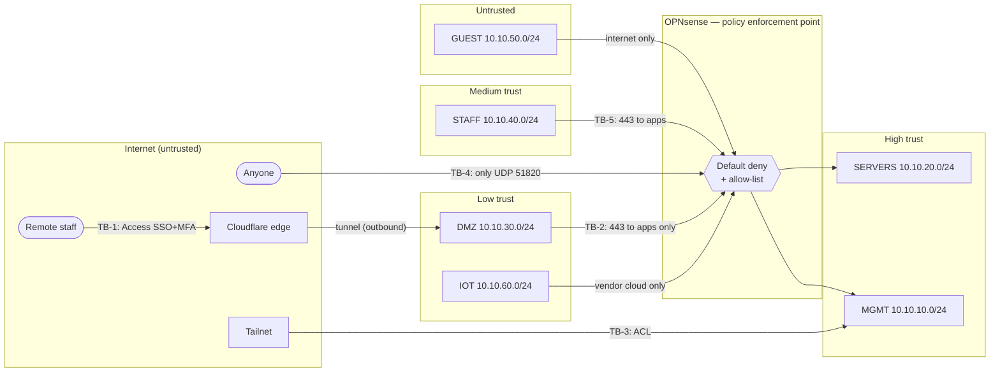

# Network Topology and Trust Boundaries

Details (IP plan, rule matrix, switch ports): [LLD network](../lld-network.md).

## 1. Physical topology

## 2. Logical zones and trust boundaries

Dashed boxes are **trust boundaries** — every arrow that crosses one passes through a
control (Cloudflare Access, OPNsense rule, Tailscale ACL). Each boundary (TB-n) is analysed in
the [threat model](../../04-security-cost/threat-model.md).

## 3. Zone summary

| Zone | Trust | Who/what lives there | Can initiate to |
|------|-------|----------------------|-----------------|
| MGMT | Highest | Hypervisor, backup, admin tooling | Everything it manages |
| SERVERS | High | Business apps, monitoring | Internet (updates), MGMT (metrics only) |
| DMZ | Low | Internet-facing connectors | Apps on 443, Cloudflare |
| STAFF | Medium | Laptops | Apps on 443, printers, internet |
| IOT | Low | Printers, devices | Vendor clouds only |
| GUEST | Untrusted | Visitors | Internet only |
