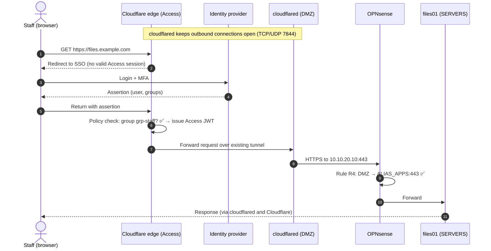
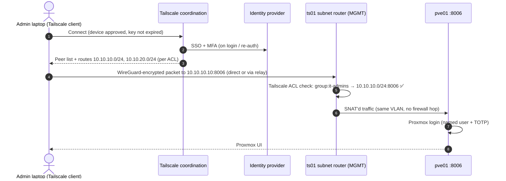
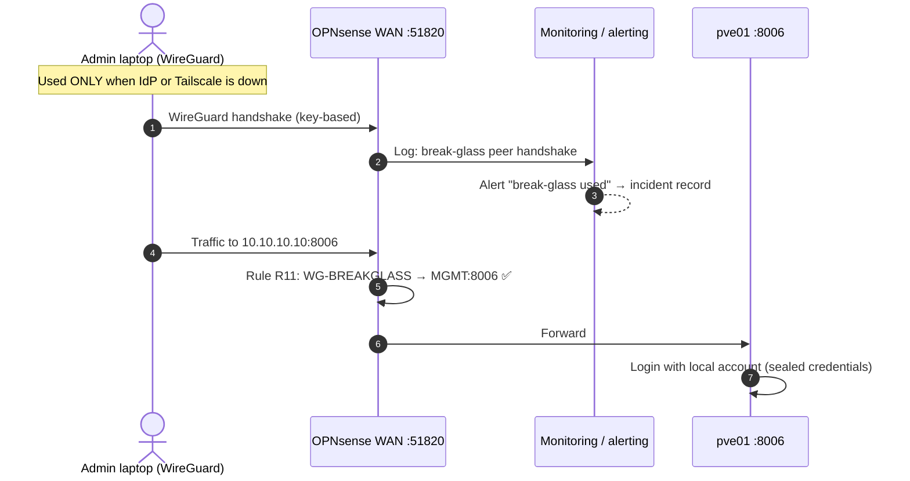
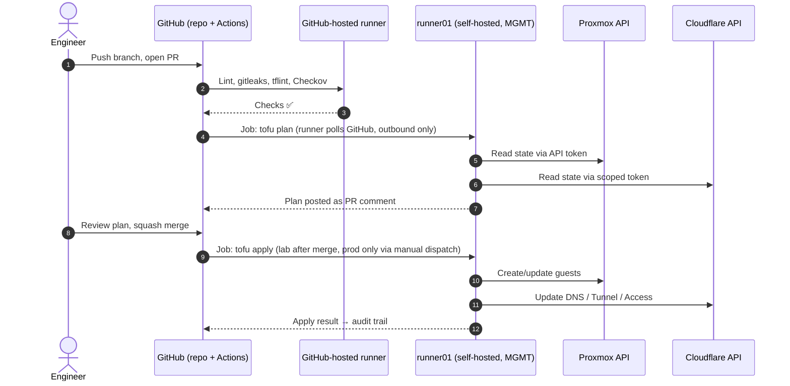
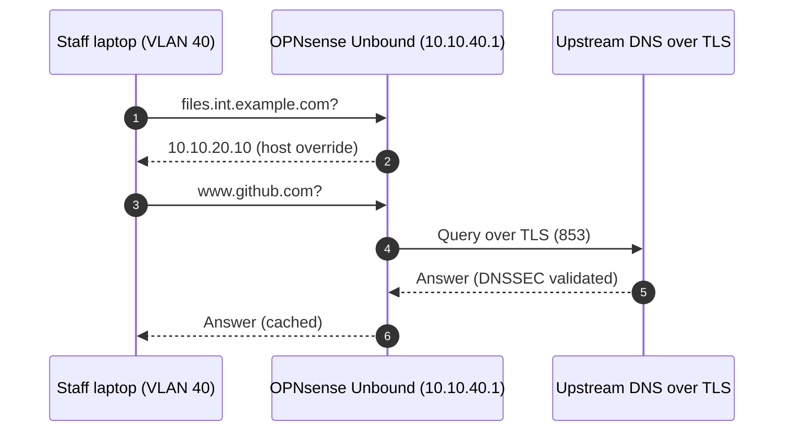

# Traffic Flows

Sequence diagrams for the main access paths. Each step names the control that protects it.

## 1. Staff opens a web app (Cloudflare Access + Tunnel)

**What an attacker sees:** only Cloudflare IPs; the office IP is never in DNS; no inbound port.

## 2. Administrator opens the Proxmox UI (Tailscale)

## 3. Break-glass access (WireGuard)

## 4. Infrastructure change through CI (GitOps)

## 5. Name resolution inside the office

