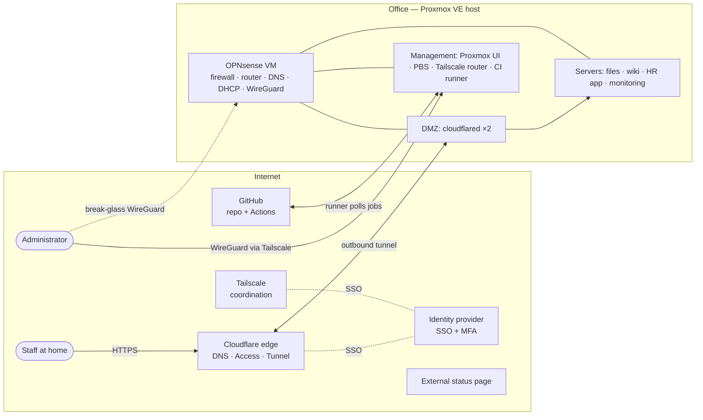

# High-Level Design — Example Corp Secure Office Platform

| | |
|---|---|
| **Document** | High-Level Design (HLD) |
| **Version** | 0.1 (draft) |
| **Status** | Proposed |
| **Owner** | Solution Architect (fridayn8) |
| **Inputs** | [Requirements](../01-requirements/requirements.md) |
| **Details** | [LLD network](lld-network.md) · [LLD compute](lld-compute.md) · [LLD access](lld-access.md) |

> Fictional scenario. All names, domains and addresses are placeholders.

## 1. Purpose and scope

This document describes the target architecture for Example Corp's on-premises platform:
virtualisation, network segmentation, secure remote access, public ingress, backup and
monitoring, all managed as code.

**In scope:** Proxmox host, OPNsense firewall, network zones/VLANs, Cloudflare Tunnel and
Access, Tailscale, WireGuard break-glass, internal apps hosting, backup, monitoring, CI runner.
**Out of scope:** see [requirements §8](../01-requirements/requirements.md#8-out-of-scope).

## 2. Architecture summary

The platform runs on **one Proxmox VE host**. **OPNsense** runs as a VM and is the router and
firewall between all **network zones** (VLANs). Nothing internal is published through inbound
ports:

- **Staff** reach web apps through **Cloudflare Access** (SSO + MFA) and **Cloudflare Tunnel**
  (outbound-only connector in the DMZ).
- **Administrators** reach management interfaces through **Tailscale** (SSO + MFA + ACLs).
- If the identity provider or Tailscale is down, a **WireGuard break-glass** tunnel on OPNsense
  gives key-based access to the management network only.
- **Backups** go to a separate **Proxmox Backup Server** appliance, with an off-site copy.
- All infrastructure is described in **Git** and changed through pull requests
  (OpenTofu, Ansible — all open source, [ADR-0011](../02-options-decisions/adr/0011-open-source-first.md)).

## 3. Key architecture decisions

| Decision | Choice | ADR |
|----------|--------|-----|
| Record decisions | MADR in Git | [ADR-0001](../02-options-decisions/adr/0001-record-architecture-decisions.md) |
| Hypervisor | Proxmox VE | [ADR-0002](../02-options-decisions/adr/0002-hypervisor-proxmox-ve.md) |
| Firewall / router | OPNsense as a VM | [ADR-0003](../02-options-decisions/adr/0003-firewall-opnsense.md) |
| Remote access | Tailscale (primary admin) + WireGuard (break-glass); Cloudflare Access for staff apps | [ADR-0004](../02-options-decisions/adr/0004-remote-access-tailscale-and-wireguard.md) |
| Public ingress | Cloudflare Tunnel, no inbound ports | [ADR-0005](../02-options-decisions/adr/0005-public-ingress-cloudflare-tunnel.md) |
| Automation | OpenTofu + Ansible, templates from Debian cloud images | [ADR-0012](../02-options-decisions/adr/0012-opentofu-and-cloud-image-templates.md) (supersedes ADR-0006) |
| Free & open source | Free-only, open-source-first | [ADR-0010](../02-options-decisions/adr/0010-free-only-tooling-policy.md), [ADR-0011](../02-options-decisions/adr/0011-open-source-first.md) |
| Secrets | SOPS + age | [ADR-0007](../02-options-decisions/adr/0007-secrets-sops-age.md) |

## 4. Logical components

| Component | Role | Zone | Type | Stateful? |
|-----------|------|------|------|-----------|
| Proxmox VE | Hypervisor, VM/LXC lifecycle | MGMT | Bare metal | Config |
| OPNsense | Routing, firewall, NAT, DHCP, DNS resolver (Unbound), WireGuard | All (trunk) | VM | Config |
| cloudflared ×2 | Cloudflare Tunnel connectors (2 replicas) | DMZ | LXC | No |
| Tailscale subnet router | Advertises MGMT and SERVERS subnets to the tailnet | MGMT | LXC | No (auth via key) |
| File service (e.g. Nextcloud) | Files and sharing | SERVERS | VM | **Yes** |
| Wiki (e.g. BookStack) | Documentation | SERVERS | LXC | Yes |
| HR app | Internal web app with personal data | SERVERS | VM | **Yes** |
| Monitoring (Prometheus, Grafana, Uptime Kuma) | Metrics, dashboards, uptime checks, alerts | SERVERS | LXC | Yes (metrics) |
| GitHub Actions runner | Executes IaC pipelines against the lab | MGMT | LXC | No |
| Proxmox Backup Server | Deduplicated, encrypted backups | MGMT | **Separate appliance** | **Yes** |
| External status page (Upptime) | Outage communication | Internet (GitHub Actions + Pages) | Open source | n/a |

Product choices for the apps are examples; the platform design does not depend on them.

## 5. Access and traffic flows

Detailed sequence diagrams: [traffic flows](diagrams/traffic-flows.md).

### 5.1 Staff access to apps

1. User opens `https://files.example.com`.
2. Cloudflare Access redirects to the identity provider → SSO + MFA → group check.
3. Cloudflare forwards the request through the existing outbound **tunnel** to `cloudflared` in the DMZ.
4. `cloudflared` connects to the app in the SERVERS zone (firewall allows DMZ → specific app ports only).

The same path is used inside the office (simpler for users, one policy). Large file transfers
inside the office may use the internal name `files.int.example.com` directly.

### 5.2 Admin access

| Path | When | How | Reaches |
|------|------|-----|---------|
| **Tailscale** (primary) | Normal operation | SSO + MFA → tailnet → subnet router → ACL check | MGMT and SERVERS per ACL |
| **On-site** | In the office | Admin laptop on the MGMT access port / admin SSID | MGMT |
| **WireGuard break-glass** | IdP or Tailscale unavailable | Pre-shared WireGuard key on 1–2 admin devices → OPNsense | MGMT only |

### 5.3 Outbound internet

All zones egress through OPNsense NAT. GUEST and IOT zones are internet-only (IOT may be
further limited to vendor cloud endpoints). Servers get outbound internet for updates.

### 5.4 Automation flow

Pull request → GitHub Actions (cloud runners: lint, security scan) → merge → job picked up by
the **self-hosted runner** in MGMT (outbound connection to GitHub; no inbound port) → OpenTofu
/ Ansible apply to the lab. Details in the delivery project (CI/CD is not part of this case).

## 6. Security architecture

| Layer | Controls |
|-------|----------|
| Edge | Cloudflare WAF, DDoS protection, Access (SSO + MFA + group policy) |
| Perimeter | OPNsense default-deny WAN; only WireGuard UDP port open |
| Segmentation | 6 zones (MGMT, SERVERS, DMZ, STAFF, GUEST, IOT); inter-zone allow-list |
| Identity | Central IdP with MFA; Tailscale and Cloudflare via SSO; local break-glass accounts sealed |
| Host | Hardened templates, automatic security updates, SSH keys only, host firewall |
| Data | Encrypted backups; off-site copy; personal data only in HR app |
| Change | All changes via PR; CI checks; audit trail in Git |
| Secrets | SOPS + age; scoped API tokens; rotation |
| Detection | Centralised logs (90 days), uptime and resource alerts |

Threats and mitigations: [threat model](../04-security-cost/threat-model.md).
Checklists: [hardening baseline](https://github.com/fridayn8/sa-projects/blob/main/projects/example-corp/docs/hardening-baseline.md).

## 7. Operations: monitoring, backup and recovery

**Monitoring:** Prometheus scrapes Proxmox, OPNsense and node exporters; Grafana dashboards;
Uptime Kuma checks each app from inside; an **external** check (Cloudflare / SaaS) detects
total site outages. Alerts go to email/chat; each alert links to a runbook (written during handover, see the playbook stage 8).

**Backup (3-2-1):**

| Copy | Location | Schedule | Retention |
|------|----------|----------|-----------|
| 1 | Production data on the Proxmox host | — | — |
| 2 | Proxmox Backup Server appliance (office) | Nightly 01:00; OPNsense config on change | 14 daily, 8 weekly, 12 monthly |
| 3 | Off-site: encrypted USB disk (PBS removable datastore), rotated | Weekly sync + rotation | 4 weekly, 12 monthly |

Backups are encrypted client-side; the off-site target cannot be deleted with credentials
stored on the production host. **Restore tests monthly** (one VM) and a **DR test yearly**.

**Recovery approach:**

| Failure | Response | Meets |
|---------|----------|-------|
| One VM broken / bad change | Revert PR or restore VM from PBS | NFR-A2 (1 h) |
| OPNsense VM broken | Restore VM from PBS, or reinstall + import config | 2 h |
| Host hardware failure | Repair/replace (NBD support), reinstall Proxmox from docs/IaC, restore in priority order | NFR-A3 (8 business hours) |
| Site loss / ransomware | Restore from off-site copy onto replacement hardware | DR plan (handover stage) |

## 8. Non-functional requirements — how they are met

| NFR | Design response |
|-----|-----------------|
| Availability 99.5 % (business hours) | Stable single host + fast restore; maintenance outside hours; 2 cloudflared replicas |
| RTO/RPO | Nightly PBS backups (RPO 24 h); documented restore order; NBD hardware support |
| Security | Zero inbound app ports, SSO + MFA, segmentation, least-privilege tokens, IaC review |
| Performance | Capacity plan with 30 % headroom; ZFS mirror on NVMe |
| Operability | Everything in Git; runbooks; one admin can rebuild stateless parts in < 1 h |
| Cost | Open source + free tiers; one extra appliance for backups |

## 9. Risks and open issues

| ID | Risk / issue | Likelihood | Impact | Mitigation / next step |
|----|--------------|:----------:|:------:|------------------------|
| R-1 | Single host is a **SPOF** — host failure stops everything incl. internet | Low | High | Accepted (cost). NBD support, tested restore, external status page. Revisit 2nd node (future ADR) |
| R-2 | OPNsense as VM: Proxmox maintenance = network outage | Medium | Medium | Maintenance windows; on-site MGMT port; consider physical firewall later |
| R-3 | Single ISP link | Medium | Medium | Accepted year 1; LTE backup router as low-cost option |
| R-4 | Dependency on Cloudflare / Tailscale / IdP SaaS | Low | Medium | Break-glass WireGuard; internal names work on-site |
| R-5 | CGNAT at ISP would break WireGuard break-glass (A-1) | Low | Medium | Confirm with ISP; fallback relay VPS |
| R-6 | Self-hosted runner has admin rights in the lab | Medium | High | Runner only for this private repo, MGMT ACLs, protected branches, required reviews |
| R-7 | Part-time admin → slow incident response | Medium | Medium | Runbooks, alerting, IT partner contract |

## 10. Transition from current state

| Step | Change | Risk |
|------|--------|------|
| 1 | Build lab (nested Proxmox) and validate design | None |
| 2 | Install PBS appliance, take full backups of current VMs | Low |
| 3 | Configure switch/AP VLANs; deploy OPNsense alongside existing router | Medium |
| 4 | Cut over routing to OPNsense in a maintenance window | Medium |
| 5 | Deploy cloudflared + Access; migrate apps one by one; close port-forwards | Low |
| 6 | Deploy Tailscale + WireGuard break-glass; remove old admin exposure | Low |
| 7 | Handover with runbooks and training (2 weeks) | Low |
| 8 | Hypercare: close support until the exit criteria are met (2 weeks) | Low |

## 11. Related documents

- [Requirements](../01-requirements/requirements.md)
- [LLD network](lld-network.md) · [LLD compute](lld-compute.md) · [LLD access](lld-access.md)
- Diagrams: [C4 context](diagrams/c4-context.md) · [C4 container](diagrams/c4-container.md) · [Network topology](diagrams/network-topology.md) · [Traffic flows](diagrams/traffic-flows.md)
- [Threat model](../04-security-cost/threat-model.md) · [Hardening baseline](https://github.com/fridayn8/sa-projects/blob/main/projects/example-corp/docs/hardening-baseline.md)
- [Capacity planning](../04-security-cost/capacity-planning.md) · [Cost estimate](../04-security-cost/cost-estimate.md)
