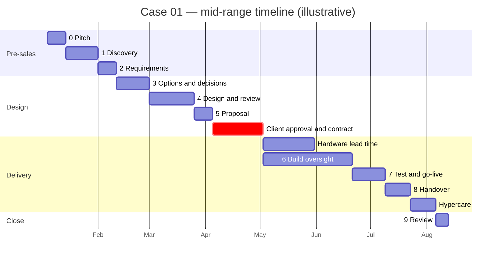

# Case 01 — Estimate and Timeline

| | |
|---|---|
| **Document** | Stage estimates, money, calendar plan, Gantt chart and status reporting |
| **Stage** | [5 Proposal and commercial](../../engagement-playbook/05-proposal-and-commercial.md) |
| **Method** | [Timeline, effort and estimation](../../engagement-playbook/timeline-and-effort.md) |
| **Worksheet** | [Estimation worksheet template](../../engagement-playbook/templates/estimation-worksheet.md) |
| **Status** | Baseline at the stage 5 gate; actuals recorded in [lessons learned](lessons-learned.md) |

> Fictional scenario. **Every figure is illustrative.** The day rate and durations are rules of thumb,
> not quotes.

## 1. Assumptions behind the numbers

| # | Assumption | Effect if false |
|---|------------|-----------------|
| E-1 | Example Corp size: 25 staff, one site, four interview groups plus the IT partner | Scale factors apply (see the timeline document) |
| E-2 | Brownfield, but documentation gaps are covered by the discovery stage | +30–50 % on discovery if worse |
| E-3 | The architect works part-time on this engagement (about 60 % of a day) | Calendar stretches, effort does not |
| E-4 | Illustrative day rate **USD 400** | Fee scales linearly |
| E-5 | The IT administrator builds (about 14 days, about two days a week); the IT partner supports (about 6 days) | Build calendar and cost change |
| E-6 | Hardware costs follow the [cost estimate](../04-security-cost/cost-estimate.md#1-capex-one-off-hardware): USD 3 400 | Pricing must be re-verified before ordering (assumption A-5) |
| E-7 | The client signs within four weeks of the proposal | Each extra week moves every later date |
| E-8 | No second site, no regulated data beyond personal data in the HR app | +15–25 % per site, +50–100 % if regulated |

## 2. Stage estimates (effort, in days)

Three-point values from the playbook worked example; expected = (O + 4 × L + P) / 6.

| Stage | O | L | P | Expected | Fee at USD 400/day | Commercial form |
|-------|--:|--:|--:|---------:|-------------------:|-----------------|
| 0 Pitch | 1 | 1.5 | 2 | 1.5 | 600 | Unpaid pre-sales, carried by the architect |
| 1 Discovery | 3 | 4 | 5 | 4.0 | 1 600 | Fixed fee (as in the [pitch](../00-pitch-discovery/02-pitch.md)) |
| 2 Requirements | 3 | 3.5 | 4 | 3.5 | 1 400 | Part of the design agreement |
| 3 Options and decisions | 3 | 4.5 | 6 | 4.5 | 1 800 | Part of the design agreement |
| 4 Design and review | 6 | 8 | 10 | 8.0 | 3 200 | Part of the design agreement |
| 5 Proposal and commercial | 2 | 3 | 4 | 3.0 | 1 200 | Part of the design agreement |
| **Design agreement (stages 2–5)** | | | | **19.0** | **7 600** | **Fixed fee** |
| 6 Build oversight | 4 | 6 | 8 | 6.0 | 2 400 | Delivery, capped time and materials |
| 7 Test and go-live | 3 | 4 | 5 | 4.0 | 1 600 | Delivery |
| 8 Handover and operate | 3 | 3.5 | 4 | 3.5 | 1 400 | Delivery |
| 9 Review | 1 | 1 | 1 | 1.0 | 400 | Delivery |
| **Delivery (stages 6–9)** | | | | **14.5** | **5 800** | **Capped at USD 7 250 (25 % contingency)** |
| **Total** | **29** | **39** | **49** | **39.0** | | |

The 25 % contingency is applied to the **remaining work at each gate**: at the stage 5 gate the
first 24.5 days (stages 0–5) are known, so contingency covers only the delivery stages
(14.5 days × 25 % = 3.6 days, USD 1 450).

## 3. Money summary

| Item | Expected (USD) | With contingency (USD) | Notes |
|------|---------------:|-----------------------:|-------|
| Architect: discovery (fixed) | 1 600 | 1 600 | Paid |
| Architect: design agreement (fixed) | 7 600 | 7 600 | Paid on delivery of the proposal |
| Architect: delivery (capped) | 5 800 | 7 250 | Billed on actual days, up to the cap |
| **Architect subtotal** | **15 000** | **16 450** | |
| Hardware | 3 400 | 3 400 | From the cost estimate; re-verify prices before ordering |
| IT partner support (about 6 days) | 3 400 | 3 400 | The partner quotes separately; not part of the cost estimate |
| **External spend** | **≈ 21 800** | **≈ 23 250** | |
| IT administrator time (about 14 days) | ≈ 4 500 | ≈ 4 500 | Internal cost, not invoiced (14 days × 8 h × USD 40) |

**Reading the numbers.** The managing director's first expectation was USD 5 000. The external spend
is about four times that, but it covers the full programme: network segmentation, secure access,
backups, documentation and handover, not only a firewall.

**Five-year view including project cost:** about USD 21.6 k (cost estimate, which excludes project
fees) + USD 18.4 k (architect and partner; hardware is already in the cost estimate CAPEX) ≈
**USD 40 k**, against an estimated benefit of about USD 54 k over five years (USD 10.9 k per year, see
[cost estimate §5](../04-security-cost/cost-estimate.md#5-value-roi-sketch)). The return is positive
but thinner than the ROI in the cost estimate suggests, because that ROI does not include the
engagement itself. The insurance renewal is not valued in this calculation.

## 4. Calendar plan

Start Monday 4 January 2027. Mid-range durations; dates follow the Gantt chart below.

| Stage | Start | End | Calendar days | What decides it |
|-------|-------|-----|--------------:|-----------------|
| 0 Pitch | 4 Jan | 14 Jan | 10 | MD availability |
| 1 Discovery | 14 Jan | 1 Feb | 18 | Interview scheduling, ISP answer |
| 2 Requirements | 1 Feb | 11 Feb | 10 | Sign-off turnaround |
| 3 Options and decisions | 11 Feb | 1 Mar | 18 | PoC environment |
| 4 Design and review | 1 Mar | 26 Mar | 25 | Two review rounds |
| 5 Proposal | 26 Mar | 5 Apr | 10 | Walkthrough with the MD |
| **Client approval and contract** | 5 Apr | 3 May | **28** | **Client budget and legal; not controlled by the architect** |
| 6 Build oversight | 3 May | 21 Jun | 49 | Builder capacity (two days a week), hardware |
| Hardware lead time | 3 May | 31 May | 28 | **Supplier delivery; on the critical path for test** |
| 7 Test and go-live | 21 Jun | 9 Jul | 18 | Maintenance window (a Saturday) |
| 8 Handover | 9 Jul | 23 Jul | 14 | Training schedule |
| Hypercare | 23 Jul | 6 Aug | 14 | Exit criteria |
| 9 Review | 6 Aug | 13 Aug | 7 | Sponsor availability |

Go-live is **Saturday 3 July 2027** (the cutover window inside stage 7, followed by a week of smoke tests and
stabilisation). Handover runs for two weeks, then two weeks of hypercare end on 6 August, and the review is
finished by mid-August,
comfortably before the insurance renewal on **1 October 2027** (about seven weeks of float). The
"before the summer holidays" wish of the MD is **not** met; this was stated openly in the proposal.

### Critical path and dependencies on the client

| Dependency | Owner | Needed by | Risk if late |
|------------|-------|-----------|--------------|
| ISP confirmation of a public address (A-1) | IT administrator | End of discovery | Break-glass design changes (risk R-5) |
| Interviews and read access | MD, IT administrator | Discovery weeks 1–2 | Discovery slips day for day |
| Signed baseline and contract | MD | 3 May | Hardware cannot be ordered; every later date moves |
| Hardware order and delivery | MD (approval), supplier | 31 May | Test and go-live cannot start |
| Builder availability (two days a week) | IT administrator | Weeks 1–7 of the build | Build stretches |
| Test users from each group | MD, HR manager | Pilot week | UAT cannot be signed |
| Saturday maintenance window | MD | Agreed in advance | Cutover delayed by a week |

### Levers if the date cannot be met

| Lever | Example |
|-------|---------|
| Move the date | Accept go-live in late July |
| Reduce the scope | Move the wiki to a second phase; the Must requirements stay |
| Add resource or cost | A second builder from the IT partner for four weeks (about USD 5 000) |
| Accept more risk | Shorten the pilot from one week to three days (a documented risk) |

## 5. Status reporting

A one-page status report every Friday during stages 6–8. Short, honest, with evidence behind the colour.

| Section | Content |
|---------|---------|
| Overall status | Green / amber / red with one sentence of reason |
| Done this week | Completed items, each linked to a requirement ID |
| Next week | Planned items and who does them |
| Blocked | What is blocked, by whom, since when |
| Risks and decisions needed | Top three from the [risk register](risk-register.md), and decisions the sponsor must take, with a date |
| Dependencies | Hardware, access, test users, windows: date promised and date confirmed |
| Change requests | Open, approved, rejected, parked (see [CR-001](change-request-cctv.md)) |
| Effort and calendar | Days used versus estimate, forecast to completion |

**Rule:** a colour needs evidence. "Green" with a missing dependency is amber.

## 6. Re-estimation at each gate

At each gate replace estimates with actuals for the finished stages, re-estimate the rest, and compare
the forecast total with the baseline in this document. The final comparison is in
[lessons learned](lessons-learned.md#3-estimate-versus-actual).
