# Engagement Playbook

How a solution architect thinks, from the **first contact** with a client to the **review after
go-live**. Ten stages, one file each. Every stage answers the same questions:

- What do I think about, and which questions do I ask?
- Which documents do I produce, and where is a template?
- How long does it usually take (effort and calendar)?
- What commonly goes wrong?
- Where can I read more?

One fictional but realistic case, [Example Corp](../case-01-example-corp/README.md), runs through
every stage, so each stage points at the real documents of that engagement.

> **Illustrative figures.** All durations in this playbook are rules of thumb for a small
> engagement (about 25 staff, one site, a part-time architect). They are **not facts**. See
> [timeline and effort](timeline-and-effort.md) for how to adapt them and how to calibrate them
> with your own experience.

## The ten stages at a glance

| # | Stage | The question it answers | Exit gate | Effort · calendar (illustrative) |
|---|-------|------------------------|-----------|----------------------------------|
| 0 | [Pitch / first contact](00-pitch.md) | Is this worth starting, and are we the right fit? | Go/no-go to start discovery; sponsor named | 1–2 d · 1–2 wk |
| 1 | [Discovery](01-discovery.md) | What is really there today, and what do people fear? | As-is confirmed by the client | 3–5 d · 2–3 wk |
| 2 | [Requirements](02-requirements.md) | What must the solution achieve, measurably? | Signed requirements baseline | 3–4 d · 1–2 wk |
| 3 | [Options and decisions](03-options-and-decisions.md) | Which option, and why not the others? | Decisions recorded, sponsor agrees on direction | 3–6 d · 2–3 wk |
| 4 | [Design](04-design.md) | How does every requirement get met? | Design and security review passed | 6–10 d · 3–4 wk |
| 5 | [Proposal and commercial](05-proposal-and-commercial.md) | What exactly do we promise, for what price? | Signed SOW or contract | 2–4 d · 1–2 wk plus client approval |
| 6 | [Build oversight](06-build-oversight.md) | Is what is built still the design? | Build complete against the definition of done | 4–8 d · 4–10 wk |
| 7 | [Test and go-live](07-test-and-go-live.md) | What proves it works, and how do we go back? | Go decision, backups verified | 3–5 d · 2–3 wk |
| 8 | [Handover and operate](08-handover-and-operate.md) | Can operations run it without me? | Operations accepts; hypercare ends | 3–4 d · 2 wk plus 2 wk hypercare |
| 9 | [Review](09-review.md) | Did we reach the business goals? What did we learn? | Report accepted | 1 d · 1 wk |

## Stage gates

Each stage ends at a **gate**: a short list of criteria and a named person who signs off. A gate
is not bureaucracy, it is the moment where you are allowed to say "not yet". Work that starts
after a failed gate is the most expensive kind of rework.

```mermaid
flowchart LR
  S0["0 Pitch"] --> G0{"Go / no-go<br/>sponsor named"}
  G0 --> S1["1 Discovery"] --> G1{"As-is<br/>confirmed"}
  G1 --> S2["2 Requirements"] --> G2{"Baseline<br/>signed"}
  G2 --> S3["3 Options and<br/>decisions"] --> G3{"Direction<br/>agreed"}
  G3 --> S4["4 Design"] --> G4{"Design and<br/>security review"}
  G4 --> S5["5 Proposal"] --> G5{"SOW<br/>signed"}
  G5 --> S6["6 Build<br/>oversight"] --> G6{"Build<br/>complete"}
  G6 --> S7["7 Test and<br/>go-live"] --> G7{"Go<br/>decision"}
  G7 --> S8["8 Handover"] --> G8{"Operations<br/>accepts"}
  G8 --> S9["9 Review"] --> G9{"Report<br/>accepted"}
  G1 -. "stakeholders or access missing" .-> S1
  G4 -. "review finds gaps" .-> S4
  G7 -. "no-go" .-> S6
```



Stages **overlap** in real life (discovery and requirements often run together, hardware can be
ordered before the whole build is planned), but a **gate is never skipped**: you can start the
next stage early, you cannot *finish* it before the previous gate is passed.

## How to use this playbook

1. Read the stage file **before** you do the work in a real engagement. Skim *Questions to ask*
   and *Common mistakes*.
2. Open the matching [Case 01](../case-01-example-corp/README.md) documents and compare them with
   the questions: what did the architect actually ask, and what was left unsaid?
3. Do the **Stop and think** boxes. Write your own answer first, then open the model answer.
4. Copy the [templates](templates/) you need and fill them in for your own engagement.
5. Record your real durations in the [estimation worksheet](templates/estimation-worksheet.md);
   after three engagements your own numbers are better than the ones here.

## Stage file structure

Every stage file has the same sections, in the same order:

```text
Goal · Typical duration · Inputs
Activities (what you actually do)
Questions to ask (client, stakeholders, yourself)
What to think about (trade-offs, hidden risks, red flags)
Documents produced
Exit gate (criteria, who signs off)
Common mistakes
Stop and think (1–3 boxes)
References
```

## Related material

| Need | Where |
|------|-------|
| Timeline, effort and estimation method | [`timeline-and-effort.md`](timeline-and-effort.md) |
| Blank engagement templates | [`templates/`](templates/) |
| Worked case with all documents | [`case-01-example-corp/`](../case-01-example-corp/README.md) |
| Reasoning exercises | [`exercises/`](../exercises/design-first-exercises.md) |
| Books, frameworks, standards by stage | [`references.md`](../references.md) |
| Generic reference: Git, glossary, design templates | [`sa-handbook`](https://github.com/fridayn8/sa-handbook) |
