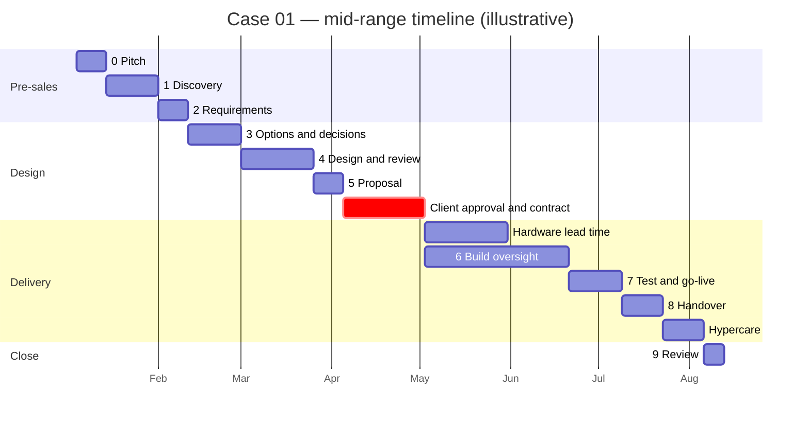

# Timeline, Effort and Estimation

How long does a professional really spend on each stage of an engagement, and why does the
calendar take so much longer than the work?

> **These figures are illustrative.** They are rules of thumb for one size of engagement: a
> company of about 25 staff, one site, a part-time architect who also works on other
> engagements. They are **not facts**, and they are not a quote. Use them as a starting point,
> adapt them with the [scale factors](#3-scale-factors), and replace them with **your own
> numbers** as soon as you have them (see [calibration](#7-calibrate-with-your-own-numbers)).

## 1. Effort versus calendar time

| Term | Meaning | Who controls it |
|------|---------|-----------------|
| **Effort** | Person-days the architect actually works | The architect |
| **Calendar (elapsed)** | Weeks from start to finish, including waiting for the client, reviews, procurement, change windows | Mostly the client and third parties |

Waiting is not work, but it still moves the deadline. The most common estimation error is to give
the client an effort figure and let them read it as a calendar figure, or the reverse.

## 2. Seed figures for an Example Corp-sized engagement

| Stage | Architect effort (days) | Calendar | What mostly decides the calendar time | My calibration (effort / calendar) |
|-------|------------------------:|----------|---------------------------------------|------------------------------------|
| 0 Pitch | 1–2 | 1–2 weeks | Client availability, internal approval to start | |
| 1 Discovery | 3–5 | 2–3 weeks | Scheduling interviews, getting access and inventory | |
| 2 Requirements | 3–4 | 1–2 weeks | Sign-off turnaround | |
| 3 Options and decisions (incl. PoC) | 3–6 | 2–3 weeks | PoC environment, vendor answers | |
| 4 Design and review | 6–10 | 3–4 weeks | Review rounds (plan two) | |
| 5 Proposal and commercial | 2–4 | 1–2 weeks **+ 2–6 weeks client procurement and legal** | Budget approval, contract (not controlled by the architect) | |
| 6 Build oversight | 4–8 (about 10–15 % of the architect's time) | 4–10 weeks | Hardware lead time (2–6 weeks), build team capacity | |
| 7 Test and go-live | 3–5 | 2–3 weeks | Maintenance window, UAT availability | |
| 8 Handover and operate | 3–4 | 2 weeks **+ 2 weeks hypercare** | Training schedule | |
| 9 Review | 1 | 1 week | — | |
| **Total** | **≈ 29–49 days** | **≈ 5–9 months** (21–40 weeks) | Client decision speed is the biggest hidden factor | |

How to read the totals: adding the stage minima gives about 23 weeks and the maxima about 40.
Stages overlap in practice (discovery and requirements run partly in parallel), which is why the
lower end is quoted as about 21 weeks. The upper end rarely shrinks: one slow decision on the
critical path delays everything behind it.

The **My calibration** column is empty on purpose. After each engagement write your own numbers
there (or, better, in the [estimation worksheet](templates/estimation-worksheet.md)); three
engagements are enough to make your figures more useful than these.

## 3. Scale factors

Adjust the seed figures before you quote them. These are illustrative too.

| Factor | Adjustment |
|--------|------------|
| Regulated or compliance-driven client (audit, data protection duties, sector rules) | **+50–100 %** (more requirements, evidence, reviews) |
| Brownfield with poor documentation | **+30–50 %** (discovery and as-is work grows) |
| Each extra site | **+15–25 %** of design and build effort |
| Reusable reference architecture available | **−10–20 %** of design effort |
| More than five stakeholder groups | **+20 %** (interviews, conflicting needs, sign-offs) |

**Worked example.** Take the 39-day expected effort of Case 01. If the same company had a second
office (+20 % of design and build effort, here design 8 d and build oversight 6 d, so +2.8 d), the
expected effort becomes about 42 days before contingency. Case 01 has five stakeholder groups, which
is not *more than* five, so that factor does not apply. If, on top, nobody had documented the
current server, +40 % of the discovery stage (4 d) would add 1.6 d, giving about 43 days. Write each factor into the assumptions so
the client sees why the number moved.

## 4. Estimation method

1. **Three-point estimate per stage.** Give an optimistic (**O**), a most likely (**L**) and a
   pessimistic (**P**) value in days, then calculate:

   ```text
   expected = (O + 4 × L + P) / 6
   ```

2. **Add 20–30 % contingency** on the total and show it as a separate line with a description of
   what it covers (unvalidated assumptions, review rounds, client delays).
3. **State the assumptions** next to the numbers. An estimate without assumptions cannot be
   discussed.
4. **Re-estimate at every stage gate**, using actuals so far. An estimate is a living document,
   not a promise made once.

**Worked example (Case 01, effort in days):**

| Stage | O | L | P | Expected |
|-------|--:|--:|--:|---------:|
| 0 Pitch | 1 | 1.5 | 2 | 1.5 |
| 1 Discovery | 3 | 4 | 5 | 4.0 |
| 2 Requirements | 3 | 3.5 | 4 | 3.5 |
| 3 Options and decisions | 3 | 4.5 | 6 | 4.5 |
| 4 Design and review | 6 | 8 | 10 | 8.0 |
| 5 Proposal and commercial | 2 | 3 | 4 | 3.0 |
| 6 Build oversight | 4 | 6 | 8 | 6.0 |
| 7 Test and go-live | 3 | 4 | 5 | 4.0 |
| 8 Handover and operate | 3 | 3.5 | 4 | 3.5 |
| 9 Review | 1 | 1 | 1 | 1.0 |
| **Total** | **29** | **39** | **49** | **39.0** |
| **With 25 % contingency** | | | | **≈ 49** |

The pessimistic total (49 days) happens to equal the expected total with contingency; that is a
useful check: if your contingency is much smaller than the gap between expected and pessimistic,
you are probably under-reserving. The full application to this case, with money and the
timeline, is in the [estimate and timeline](../case-01-example-corp/05-proposal-delivery/estimate-and-timeline.md)
document.

## 5. Calendar versus effort: why 39 days becomes 8 months

**Part-time availability.** An architect shared across two to four engagements delivers about
**50–70 %** of a calendar day to one of them. The minimum calendar time imposed by capacity alone is:

```text
calendar weeks ≥ effort days / (availability × 5 days per week)
39 days / (0.6 × 5) = 13 weeks
```

**Waiting time.** Thirteen weeks of capacity becomes about 32 weeks on the calendar (the Gantt chart
below has 221 days) because of the things nobody works on while they happen: interviews that cannot
be scheduled for two weeks, sign-offs that sit in an inbox, a client budget cycle, hardware in
transit, a maintenance window on the next free Saturday. These are real, so show them to the
client as a **separate column** in the plan.

**Practical consequences**

- Quote the calendar as a range and name the dependencies that move it.
- Ask the client for *named people* and *dates* for each of their tasks (interviews, access,
  UAT users, the change window). Their availability is part of the plan, not a favour.
- Protect your own capacity: a second engagement starting in the middle of stage 6 can stretch the
  calendar by weeks without adding any effort.

## 6. Deadlines and stage gates

**A deadline is a series of gates, each with an owner.** "Go-live by 31 May" decomposes into
"requirements signed by day X", "contract signed by day Y", "hardware ordered by day Z",
"maintenance window booked for day W". For each, ask: who owns it, when is it due, and what
happens if it slips?

**The critical path.** In Case 01 the critical path runs through two things the architect does not
control: **client approval and contract** (about 4 weeks) and **hardware lead time** (about 4
weeks, partly in parallel with the build). Everything else has float, or can be compressed
with more effort. Watch the critical path weekly.

**What can run in parallel**

| Together | Why it works | The catch |
|----------|--------------|-----------|
| Discovery and requirements | Requirements take shape while interviews continue | Do not sign before the as-is is confirmed |
| Hardware ordering and the build | Order long-lead items as soon as the design and budget are agreed | Order only what the design and SOW cover, in writing, with a returns clause |
| Design review and proposal drafting | The proposal text can start while the reviewer reads | Price after the review finds the gaps |
| Runbook writing and build | Write while the memory is fresh | Test the runbooks in stage 8 |

**How to say *no* or *re-scope* when the date cannot be met**

1. State the facts first: "Given contract signature by day Y and hardware lead time of 4 weeks,
   the earliest safe go-live is date D."
2. Offer the client **three levers**, and make them choose: *move the date*, *reduce the scope*
   (name what moves to a second phase), *add resource or cost* (name who and how much). The fourth
   lever, *accept more risk*, is theirs to take in writing.
3. Never absorb the gap silently by cutting testing, review or documentation. Those are the first
   things that make the next incident expensive.
4. Write the agreed lever into the plan and the risk register.

## 7. Calibrate with your own numbers

The [estimation worksheet](templates/estimation-worksheet.md) has a column for **actual** effort and
calendar time and the **delta**. Fill it in at each gate. After three engagements:

- Compare delta by stage: you will see where you are consistently low (often stage 1, because
  access takes longer, and stage 6, because change requests accumulate).
- Turn the pattern into a personal factor (for example "stage 6: multiply by 1.3").
- Replace the seed figures in your own copy of this table.

## 8. Timeline diagram for Case 01

The chart uses mid-range values and a start date of 4 January 2027. It is **illustrative**; the
critical path is the highlighted client approval.



**Reading the chart**

- Pre-sales to proposal takes about 91 calendar days (13 weeks) for about 24 days of effort.
- The longest bar in the middle is waiting, not work: **28 days of client approval and
  contract**. No amount of architect effort shortens it.
- Hardware lead time runs **inside** build oversight; if the hardware arrives late, test and
  go-live start late, whatever the builders do.
- The whole engagement is about 221 days (about 32 weeks, about 7 months): inside the 5–9 month
  range of the seed table.

## Related

- [Estimation worksheet](templates/estimation-worksheet.md) · [Case 01 estimate and timeline](../case-01-example-corp/05-proposal-delivery/estimate-and-timeline.md)
- Estimation and planning books and standards: [references](../references.md#estimation-and-planning)
