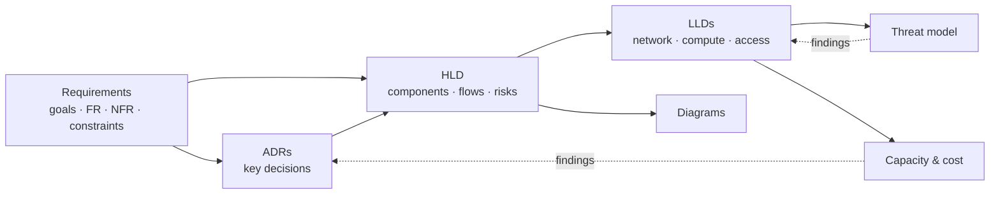

# Design-First Exercises

> **Goal:** think like a Solution Architect *before* building anything: understand the need,
> make decisions explicit, and produce a design others can review, build and operate.
>
> These exercises work on the [Case 01](../case-01-example-corp/README.md) documents. Do them after
> reading the [engagement playbook](../engagement-playbook/README.md) stages 2–4.

## 1. Concepts

| Concept | Why it matters | Where in Case 01 |
|---------|----------------|--------------------|
| **Requirements → design traceability** | Every design element must serve a requirement; every requirement must be met somewhere | [requirements §9](../case-01-example-corp/01-requirements/requirements.md#9-traceability) |
| **NFRs drive architecture** | Availability, security and cost targets — not features — decide most of the design | [requirements §5](../case-01-example-corp/01-requirements/requirements.md#5-non-functional-requirements) |
| **Constraints and assumptions** | Constraints remove options; assumptions are risks until validated | [requirements §6–7](../case-01-example-corp/01-requirements/requirements.md#6-constraints) |
| **HLD vs LLD** | HLD explains *what and why* to many audiences; LLD gives builders *exact values* | [HLD](../case-01-example-corp/03-design/hld.md), [LLDs](../case-01-example-corp/03-design/) |
| **ADRs** | Decisions with options and trade-offs, reviewable and permanent | [ADR index](../case-01-example-corp/02-options-decisions/adr/README.md) |
| **C4 + diagrams as code** | Different zoom levels for different audiences; diagrams versioned with the text | [diagrams](../case-01-example-corp/03-design/diagrams/) |
| **Threat modelling (STRIDE)** | Security designed in, per trust boundary | [threat model](../case-01-example-corp/04-security-cost/threat-model.md) |
| **Capacity and cost** | A design the business cannot afford or that runs out of disk in year 2 is not a solution | [capacity](../case-01-example-corp/04-security-cost/capacity-planning.md), [cost](../case-01-example-corp/04-security-cost/cost-estimate.md) |

## 2. The order the documents were written (and why)

In practice it is **iterative**: the capacity plan found that backup storage becomes tight in
year 3 (feeds a future decision); the threat model added handshake alerting to break-glass
(fed back into the LLD).

## 3. Hands-on exercises

Do each exercise as **issue → branch → PR → squash merge** to keep practising the Git workflow.

| # | Exercise | Skills | Suggested branch |
|---|----------|--------|------------------|
| 1 | Read the requirements and HLD. Open an issue listing 3 questions you would ask the stakeholders. | Discovery, critical reading | — (issue only) |
| 2 | Change NFR-A3 from 8 business hours to **2 hours**. Trace what must change (HLD, ADRs, cost). Write it up in a PR description — don't change the design. | Traceability, trade-offs | `docs/nfr-impact-analysis` |
| 3 | Write **ADR-0009: Off-site backup target** (USB disk rotation vs remote PBS at a second location vs free cloud tiers) using the template, status `proposed`. | ADR writing | `docs/adr-0009-offsite-backup` |
| 4 | Add a **CCTV zone** (VLAN 70): update the VLAN table, rule matrix and threat model (new TB?). | LLD, segmentation, STRIDE | `feat/network-cctv-vlan` |
| 5 | Redo the backup capacity table with **2 × 12 TB** disks and update the cost estimate. | Capacity planning, cost | `docs/capacity-pbs-12tb` |
| 6 | Draw a **C4 component** diagram (level 3) for one app of your choice. | Diagrams as code | `docs/c4-component-files` |
| 7 | In your laptop lab, check assumption A-2 (VLAN-aware bridge, two NICs) by creating `vmbr1` VLAN-aware in nested Proxmox. Record the result in the PR. | Validating assumptions | `docs/validate-assumption-a2` |

## 4. The documents you are working on

- [Requirements](../case-01-example-corp/01-requirements/requirements.md)
- [HLD](../case-01-example-corp/03-design/hld.md) and the LLDs:
  [network](../case-01-example-corp/03-design/lld-network.md),
  [compute](../case-01-example-corp/03-design/lld-compute.md),
  [access](../case-01-example-corp/03-design/lld-access.md)
- [Diagrams](../case-01-example-corp/03-design/diagrams/): C4 context, C4 container, network topology, traffic flows
- [ADRs 0002 … 0012](../case-01-example-corp/02-options-decisions/adr/README.md)
- [Threat model](../case-01-example-corp/04-security-cost/threat-model.md)
- [Capacity planning](../case-01-example-corp/04-security-cost/capacity-planning.md) and
  [cost estimate](../case-01-example-corp/04-security-cost/cost-estimate.md)
- Your own results for exercises 1–7 — **by you**

## 5. Definition of Done

- Every functional requirement and NFR appears in the traceability table.
- Every ADR lists at least three options with pros/cons.
- Every trust boundary in the topology diagram appears in the threat model.
- Capacity plan shows ≤ 70 % utilisation at year 3 — or a documented finding/decision.
- All diagrams render on GitHub.

## 6. Reflection questions

1. Which NFR had the biggest influence on the design? What would change if it were relaxed?
2. The design accepts a single host as a SPOF. Is that the right call for this business? What evidence would change your mind?
3. Why do staff use Cloudflare Access but admins use Tailscale? What would go wrong if both used the same path?
4. Which assumption is the riskiest, and how would you validate it cheaply?
5. Over five years, people cost is ~60 % of TCO. Which parts of the design reduce that cost?
6. What would a security reviewer challenge first in the threat model?

## 7. Further reading

- *Software Architecture for Developers* / C4 model — <https://c4model.com/>
- MADR — <https://adr.github.io/madr/>
- OWASP Threat Modeling — <https://owasp.org/www-community/Threat_Modeling>
- AWS Well-Architected Framework (pillars apply on-prem too) — <https://docs.aws.amazon.com/wellarchitected/latest/framework/welcome.html>
- Proxmox VE documentation — <https://pve.proxmox.com/pve-docs/>
- OPNsense documentation — <https://docs.opnsense.org/>
- Cloudflare Tunnel — <https://developers.cloudflare.com/cloudflare-one/connections/connect-networks/>
- Tailscale ACLs / policy file — <https://tailscale.com/kb/1018/acls>

## Next step

Build it: the hands-on implementation lives in the
[`sa-projects`](https://github.com/fridayn8/sa-projects) repository.
